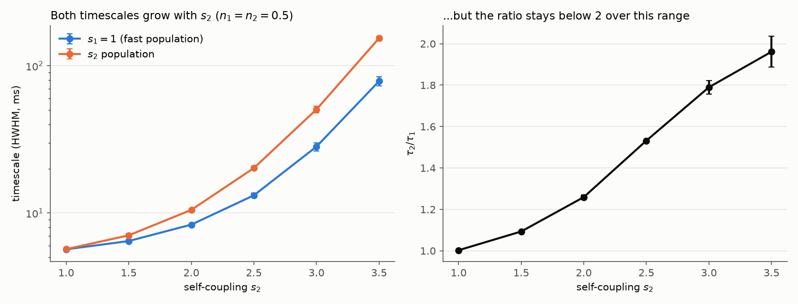
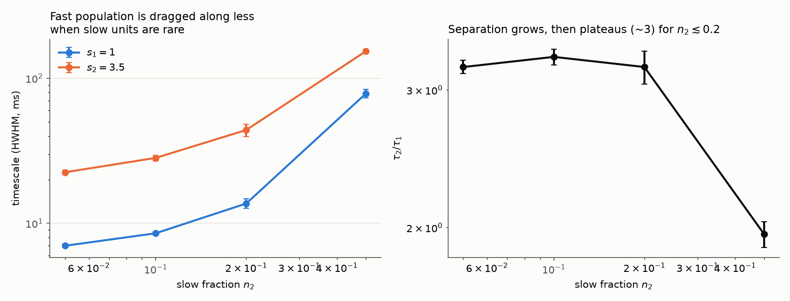
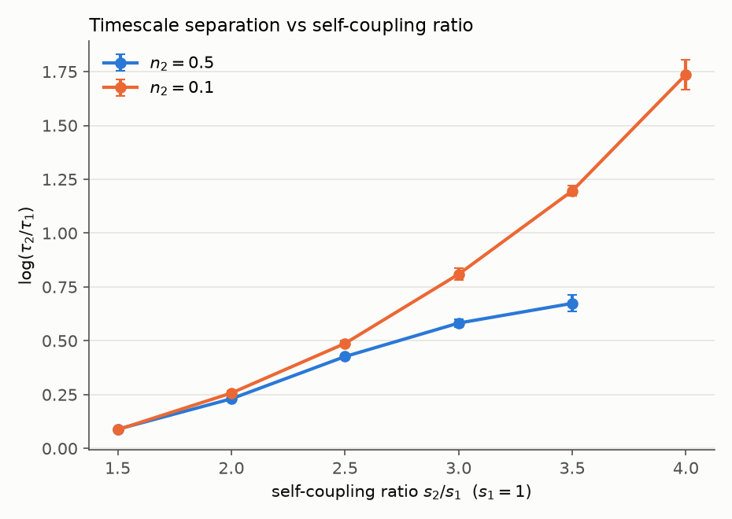
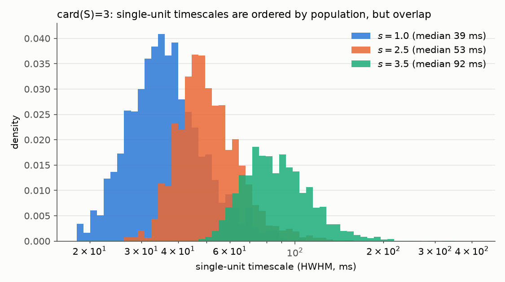

# A reservoir of timescales in random neural networks

Code accompanying Stern, Istrate & Mazzucato, [*A reservoir of timescales in random neural networks*](https://arxiv.org/abs/2110.09165).

The model is a random recurrent rate network whose units have heterogeneous
self-couplings `s_i`:

```
dx_i/dt = -x_i + s_i tanh(x_i) + sum_{j != i} J_ij tanh(x_j),    J_ij ~ Normal(0, g^2 / N)
```

Units sharing a self-coupling form a population. The paper shows that the
network then contains one timescale per distinct self-coupling (`card(S)`
timescales), measured as the half width at half maximum (HWHM) of the
autocorrelation function of `tanh(x)`.

## Setup

```bash
git clone https://github.com/nistrate/multipleTimescalesRNN.git
cd multipleTimescalesRNN
python3 -m venv .venv && source .venv/bin/activate
pip install -e ".[notebook,dev]"
```

TensorFlow is **no longer required**: the autocorrelation is now computed with
NumPy's FFT.

## Usage

```python
from rnn_library import make_coupling_matrix, simulate, population_acfs, timescales
import numpy as np

N_values, s_values = [750, 750], [1.0, 3.0]
J = make_coupling_matrix(N_values, s_values, g=2.0, rng=0)
t, x = simulate(J, t_end=2000, dt=0.1, transient=50, rng=0)

max_lag = 8000
acfs = population_acfs(x, N_values, max_lag=max_lag)       # one averaged ACF per population
print(timescales(np.arange(max_lag) * 0.1, acfs))          # HWHM in ms, one per population
```

| Path | Contents |
|---|---|
| `rnn_library/network.py` | `make_coupling_matrix`, `simulate` |
| `rnn_library/analysis.py` | FFT autocorrelation, per-population ACFs, HWHM timescales |
| `rnn_library/plotting.py` | ACF + example-traces figure |
| `A reservoir of timescales in random neural networks.ipynb` | Summary of the paper's model and a worked example |
| `misc/UI_version.ipynb` | Same, with interactive prompts for the parameters |
| `experiments/validate_claims.py` | Numerical checks of the paper's claims (see below) |
| `tests/` | `pytest` suite |

Run the tests with `pytest`.

## Checking the paper's claims

`python experiments/validate_claims.py` runs 67 independent simulations in
parallel (N=1000 units, g=2, 6000 ms each, ~20 min on 32 cores; finished runs are cached) and writes figures and raw
data to `results/`. 
All numbers are mean ± s.d. over 4 networks (3 for the K = 3 case), `g = 2`, `N = 1000`,
6000 ms of data after a 200 ms transient, HWHM timescales in ms.

| Claim (paper) | Result here |
|---|---|
| **One timescale per distinct self-coupling** (`card(S)`) | Supported, with a caveat. For `s = (1, 2.5, 3.5)` the three population timescales are clearly ordered (38.8 ± 1.8, 52.7 ± 2.5, 91.3 ± 5.4). Single-unit timescales are ordered by population (medians 39 / 53 / 92) but **overlap heavily** (`results/three_pops.png`). I did not separate estimation noise from true within-population spread, so this does not show sharp, discrete timescales. |
| **`tau2/tau1` grows with `s2/s1`** | Supported. At `n1 = n2 = 0.5`, `tau2/tau1` rises monotonically from 1.0 (`s2 = 1`) to 2.0 (`s2 = 3.5`). |
| **`log(tau2/tau1)` is supralinear in `s2/s1` as `n2/n1 -> 0`** | Supported. At `n2 = 0.1`, `log(tau2/tau1)` is convex in `s2` (0.08, 0.27, 0.48, 0.81, 1.2, 1.74 for `s2 = 1.5 ... 4`); at `n2 = 0.5` it flattens instead (`results/scan_s_rare.png`). |

Observations the notebook's `n1 = n2 = 0.5` setup does not show:

* **The "fast" population slows down too.** `tau1` (with `s1 = 1`) rises from 5.7 ms
  (`s2 = 1`) to 78.5 ms (`s2 = 3.5`), because all units share one mean field.
  Separation is therefore modest (ratio about 2) when both populations are large.
* **Separation plateaus in `n2`.** With `s = (1, 3.5)`, `tau2/tau1` is 2.0, 3.2, 3.3 and 3.2 for
  `n2 = 0.5, 0.2, 0.1, 0.05`. The separation grows when the slow population shrinks from
  50% to about 20%, and does not grow further for smaller `n2` at this `s`.
* **Estimates depend on `N`, run length and seed.** The notebook example (`N = 1500`, 2000 ms,
  one seed) gives `tau = 23 / 43 ms` for `s = 1 / 3`, while the `N = 1000`, 6000 ms, 4-seed
  runs here give `28 / 50 ms`; a small `N = 200`, 1000 ms run gave ~100 ms for both
  populations. These comparisons change several things at once, so I have not isolated
  finite-size effects; use `N >= 1000`, long runs and several seeds before quoting numbers.

Not checked: the paper's transition-to-chaos line `s_c(g)`, the mean-field fixed-point
stability criterion, the switching-time scaling `log T ~ s^2 - s log s`, and the
spiking-network and input-demixing sections.







## Changes in this version

* **Bug fix:** with more than two populations the old notebooks assigned the
  wrong units to the third and later populations (`temp_pos_var = N_values[idx]`
  instead of accumulating), so the ACFs and timescales of K > 2 networks were
  wrong. Population bookkeeping now lives in one tested function.
* **Bug fix:** the half-max search compared `signs[0:-2]` with `signs[1:-1]`, so
  a crossing in the last interval was missed, and failure returned `None`
  after a `print`. It now returns `nan` with a `RuntimeWarning`.
* Naming: the quantity is the half width at half maximum, not the FWHM; the
  comment "variance g/sqrt(N)" described the standard deviation.
* Seeded, reproducible networks (`rng=`); the transient is discarded inside
  `simulate`.
* Dropped the TensorFlow / TensorFlow-Probability dependency, replaced the
  deprecated `mpl_toolkits.axes_grid`, fixed the dependency typo
  (`tensorflow-probabilitymatplotlib`) in the old README, removed committed
  `__pycache__` / checkpoint files, added `.gitignore`, `pyproject.toml`, tests.
* The ACF is an explicit, documented estimator (uncentered, biased `1/T`, FFT). It has not
  been compared numerically against the old TFP call (TensorFlow is not installed here),
  so timescales may differ slightly from the old notebook's saved figure.
